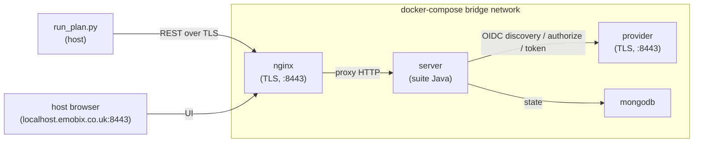

# OIDC Conformance Suite harness

Runs the [OpenID Foundation Conformance Suite][suite] against the
provider, end-to-end, in three Docker containers (MongoDB + Java
suite + our provider).

[suite]: https://gitlab.com/openid/conformance-suite

## What this is for

`tests/test_conformance.py` and `tests/test_integration_mock_rp.py`
are our own regression tests; they catch the bugs *we know about*.
The conformance suite catches the bugs *the spec writers know about*
— corner cases of OIDC Core 1.0, RFC 6749, RFC 7009, RFC 7636, etc.,
that an in-tree test wouldn't think to check. Run it before tagging
a release and after any change to the protocol surface.

## Prerequisites

- Docker 24+ (uses Compose V2 — `docker compose`, not `docker-compose`)
- ~2 GB free disk for the suite + MongoDB images (pulled from
  `registry.gitlab.com/openid/conformance-suite{,/nginx}`; pinned to
  release-v5.1.45 by default)
- Ports 8443 (suite) and 8444 (provider) free on the host loopback
  (both are published on `127.0.0.1` only)
- `/etc/hosts` entry `127.0.0.1 localhost.emobix.co.uk` (the public
  DNS record points there too, so this is usually only needed when
  your network resolver blocks the lookup)

## One-shot run

```sh
uv run nox -s conformance
```

The session:

1. Generates the TLS files under `tests/conformance/tls/` when any of
   the four is missing or a certificate expires within 30 days.
2. `docker compose -f tests/conformance/docker-compose.yml up -d --wait`
   - brings up the stack (compose project `allianceauth-oidc-conformance`)
   and blocks on health checks.
3. `python tests/conformance/run_plan.py` - submits the default
   `oidcc-config-certification-test-plan` (1 module; `nox -s
   conformance_basic` runs `oidcc-basic-certification-test-plan`, ~35
   modules), polls each, exits non-zero if any module fails.
4. `docker compose down -v` - tears the stack down.

The Config plan takes about 2 minutes, the Basic plan 10-30 minutes.

## Manual / iterative use

When iterating on a specific module, drive the suite from its UI:

```sh
docker compose -f tests/conformance/docker-compose.yml up -d --wait
open https://localhost.emobix.co.uk:8443
```

The browser will warn about a self-signed cert; that's expected. The
suite UI lets you create plans, run individual modules, and inspect
trace logs.

## Run a different plan

```sh
# Smoke run (fewer modules, ~2 minutes):
uv run python tests/conformance/run_plan.py --plan oidcc-test-plan

# Other certification plans (query the suite for the full list):
curl -ks https://localhost.emobix.co.uk:8443/api/plan/available \
  | python -c "import json,sys; [print(p['planName']) for p in json.load(sys.stdin) if p['planName'].startswith('oidcc-')]"
```

Use `--strict-warnings` to fail the run on WARNING-level results
(e.g. when preparing a certification submission).

## Run only specific modules

To iterate on a subset of modules (e.g. the ones still listed in
`expected_failures.json`) without paying for the full plan, pass
`--include`:

```sh
uv run nox -s conformance -- \
  --plan oidcc-basic-certification-test-plan \
  --include \
    oidcc-server \
    oidcc-userinfo-get \
    oidcc-userinfo-post-header \
    oidcc-userinfo-post-body \
    oidcc-ensure-request-without-nonce-succeeds-for-code-flow \
    oidcc-response-type-missing
```

The summary distinguishes `FILTERED` modules from real outcomes, and
filtered modules do not influence the exit code — they were never
sent to the suite. Use `--exclude MODULE [MODULE ...]` to drop a
single known-broken module while still running the rest. If you mix
`--include` with `--exclude`, the include allow-list is applied
first, then the exclude denylist.

A typo in `--include` (a name no module in the plan carries) is
logged as `ERROR --include names not present in plan (typo?): ...`
and the runner exits 2 before running any module. A run in which no
module executed (everything filtered out) exits 1 with
`!!! NO MODULE EXECUTED`.

`--include` and `--exclude` both accept `fnmatch` glob patterns:

```sh
# Skip every userinfo-* module (HtmlUnit hangs after the first
# browser-driven module, this excludes the visibly-affected family):
uv run nox -s conformance -- \
  --plan oidcc-basic-certification-test-plan \
  --exclude 'oidcc-userinfo-*'

# Run only the id_token negative tests:
uv run nox -s conformance -- \
  --plan oidcc-basic-certification-test-plan \
  --include 'oidcc-id-token-*'
```

A pattern without glob metacharacters degrades to exact equality, so
plain names keep working unchanged.

## Archive results to HTML

After a discovery run it's often useful to keep the suite's full
event log per module — for review, attaching to a certification
submission, or comparing against the next run. Pass `--export-dir`:

```sh
uv run nox -s conformance -- \
  --plan oidcc-basic-certification-test-plan \
  --export-dir .artifacts/conformance/reports
```

The runner downloads `GET /api/plan/exporthtml/{plan_id}` and writes
zip archives into the directory you pass (the runner `mkdir -p`s it
for you). In shared mode that is a single `{plan_id}.zip`; under
`--isolated` every module runs in its own plan, so the runner
exports one `{module-name}-{plan_id}.zip` per executed module
(exporting the shared "catalogue" plan would 404 — no test ever ran
inside it). `.artifacts/` is the project-wide ephemeral-output
bucket — gitignored and dockerignored, separate from `dist/`
(wheel/sdist build output). Mirrors the upstream
`conformance.py:exporthtml()` pattern.

## Expected failures (XFAIL / XPASS)

For long-lived green CI you want known-broken modules acknowledged
without polluting the run with red. Pass `--expected-failures
FILE.json`; every entry pins the exact result it acknowledges:

```json
{
  "oidcc-scope-address": {
    "result": "SKIPPED",
    "reason": "address scope not advertised in discovery"
  }
}
```

A listed module that finishes with exactly the pinned `result` is
re-bucketed as `XFAIL` and does NOT influence the exit code. Any
other non-passing result of that module (e.g. `FAILED` for an entry
pinned to `SKIPPED`) stays a real failure, so an acknowledged skip
cannot mask a regression. A listed module that does not fail
(`PASSED`, `REVIEW` or `WARNING`) is an `XPASS` and fails the run
(exit 1): the stale entry would mask the module's next regression,
so edit it out. A plain-string value (`"module": "reason"`, the
schema without a pinned result) and an entry pinning a non-failure
result are rejected at load time; `run_plan.py` exits 2 with the
reason.

`nox -s conformance` and `nox -s conformance_basic` apply the
shipped `tests/conformance/expected_failures.json` unless you pass
your own `--expected-failures FILE` or `--expected-failures=FILE`.
The runner does not accept abbreviated flags.

Results are classified by allowlist: only `PASSED` (counted as
`passed`), `REVIEW` (`review`) and `WARNING` (`warned`) are
non-failures. Everything else, including `UNKNOWN` / `INTERRUPTED`
for a module the suite stopped before its verdict and any result
code a future suite release adds, counts as a failure.

`REVIEW` means the module's automated checks passed but the suite
attached a screenshot a human must inspect. It does not change the
exit code, but it is not certification evidence: the summary lists
those modules under `!!! NEEDS HUMAN REVIEW`.

A module still running when the 360 s poll deadline expires is
reported as `TIMEOUT` and stopped on the suite (`DELETE
/api/runner/{id}`), so it does not keep the plan alias for the next
module.

## Per-module restart loop

Since the implicit-submission race fix (the `Wait for implicit
submission` browser task in `runner/plan_config.py`) a shared-stack
run normally yields a clean partition on its own. When you still
suspect suite-side state contamination, the per-module orchestrator
tears the stack down between every module so each one gets a fresh
JVM:

```sh
tests/conformance/run_per_module.sh \
  --plan oidcc-basic-certification-test-plan \
  --results-dir .artifacts/conformance/results \
  -- --exclude 'oidcc-userinfo-*'
```

`--results-dir` defaults to `.artifacts/conformance/results`. Every
run writes into its own fresh subdirectory `run-<UTC timestamp>/`
under it (printed as `==> results: ...`), so a JSON left by an
earlier run is never read.

How it works:

1. Brings the stack up once and calls `run_plan.py --list-modules`
   to enumerate the plan into `RUN_DIR/modules.txt`; tears down.
2. For each module: `compose up` -> `run_plan.py --include MODULE
   --summary-json RUN_DIR/MODULE.json` -> `compose down -v`. The
   loop continues past a failing module and records each
   `run_plan.py` exit code in `RUN_DIR/exit_codes.tsv`.
3. Runs `aggregate_summaries.py RUN_DIR --expected-modules
   RUN_DIR/modules.txt --plan-name PLAN --exit-codes
   RUN_DIR/exit_codes.tsv` to produce the combined summary in the
   same format `emit_summary` prints for a single run.

The aggregator accounts for every listed module: a missing,
unreadable or result-less `MODULE.json`, a file written for another
plan, and a `run_plan.py` exit code other than 0 or 1 (harness
crash: argparse error, signal, OOM kill) are reported as `ERROR` for
that module, with the reason on stderr, and fail the aggregate.

Anything after `--` is forwarded verbatim to `run_plan.py` (the
discovery call included, so a broken ledger fails before the loop),
so filters, `--strict-warnings`, `--expected-failures` and the like
all work the same way; `--strict-warnings` and the ledger that
reached `run_plan.py` are also passed to the aggregator. Run the
script from the repository root; elsewhere it exits 2.

**Cost**: ~30s of compose lifecycle × N modules. For the basic-cert
plan (~35 modules) the run is ~70-80 minutes versus ~30-50 minutes
for shared-stack. Use this only when you need a clean partition;
day-to-day iteration should stay on `nox -s conformance`.

## Baseline expected_failures.json

`tests/conformance/expected_failures.json` records the known status
of every basic-cert module that does NOT pass cleanly today. All
remaining entries pin `"result": "SKIPPED"` (bucketed as failures by
the runner unless acknowledged here, so a silent skip cannot
masquerade as coverage):

1. `oidcc-unsigned-request-object-…-or-rejected-as-unsupported` —
   the provider rejects `request` / `request_uri` with the OIDC
   Core 1.0 §6.1 / §6.2 `request_not_supported` /
   `request_uri_not_supported` errors (see
   `AuthAuthorizationView._reject_unsupported_request_object` and
   `tests/test_authorize_security.py::TestRequestNotSupportedRejection`).
   That is spec-permitted behaviour, and the suite acknowledges it
   by skipping the module ("request objects cannot be tested").
   `oidcc-ensure-request-object-with-redirect-uri` needs no entry
   any more: its invalid query `redirect_uri` now falls through to
   DOT's 400 error page (redirecting the rejection to a registered
   URI would fail
   `EnsureOPDoesNotUseDefaultRedirectUriInCaseOfInvalidRedirectUri`),
   the error-page browser task uploads the screenshot, and the
   module finishes as REVIEW.
2. `oidcc-scope-{address,phone,all}` — skipped by the suite because
   we do not advertise these scopes in discovery.

The pre-2026-07-28 ledger blamed ~15 TIMEOUTs on "HtmlUnit 4.11.1
upstream". That attribution was wrong: the browser flow always
completed, but the suite's `implicitCallback.html` delivers the
authorization response back to the suite via an async XHR, and in
HtmlUnit that background job raced WebRunner teardown. The
`Wait for implicit submission` browser task in
`runner/plan_config.py` pins the window open until the page's own
`#submission_complete` marker appears, which removed the entire
flaky class (12 modules went green in one run).

The remaining reds then resolved to: forced re-auth modules
(`oidcc-prompt-login`, `oidcc-max-age-1`) now finish as REVIEW —
the browser automation uploads the second-login-page screenshot the
suite wants a human to look at; `oidcc-refresh-token` was a seeding
bug (client2 must whitelist the primary callback, see `seed.py`);
`oidcc-userinfo-post-header` was a real provider bug (dropped
`csrf_exempt` on the userinfo view — fixed, with a regression test
in `tests/test_userinfo.py`); the JAR pair resolved once the
provider gained the §6.1 `request_not_supported` rejection.
The login-page screenshot is deliberately routed only to
positive-flow visits — see the browser-entry ordering rationale in
`runner/plan_config.py` and the guard tests in
`tests/test_conformance_runner.py`.

`run_per_module.sh` and the `conformance` / `conformance_basic` nox
sessions automatically pass
`--expected-failures tests/conformance/expected_failures.json` if
the operator did not override it. With the
baseline in place, a default per-module run prints `xfail=N
xpass=0` and exits 0 - green CI baseline, while any `XPASS` fails
the run: an entry has gone stale and should be removed.

## Discovery: which modules pass on this machine?

For a clean PASS/FAIL split, run with `--isolated` — each module
gets a fresh plan instance, so plan-level state cannot leak between
modules (note: the suite JVM and its browser thread pool are still
shared; only `run_per_module.sh` gives a fresh JVM):

```sh
uv run nox -s conformance -- \
  --plan oidcc-basic-certification-test-plan \
  --isolated
```

Cost: ~1-2 seconds of plan-creation overhead per module, negligible
on a ~30-minute basic-cert run. After a mixed run (some PASS, some
FAIL), the summary prints copy-pasteable groups:

```text
=== Module groups ===
# Allowlist (PASSED + REVIEW + WARNING) - paste into --include:
oidcc-server
oidcc-userinfo-get
...

# Denylist (every other result) - paste into --exclude:
oidcc-id-token-bad-sig
...
```

The next run can be locked to the discovered allowlist with
`--include …` (no `--isolated` needed once the set is stable).

## Configuration

`run_plan.py` reads these environment variables on the host and
falls back to the defaults in `runner/config.py`; override them when
targeting another deployment. Compose passes only
`CONFORMANCE_PUBLIC_URL` through to the provider (as its issuer), so
any other override must also reach `seed.py` in the container:

| Variable                    | Default                                                       | What it controls                            |
|-----------------------------|---------------------------------------------------------------|---------------------------------------------|
| `CONFORMANCE_SUITE_URL`     | `https://localhost.emobix.co.uk:8443`                         | Suite REST endpoint (driven by run_plan.py) |
| `CONFORMANCE_PUBLIC_URL`    | `https://provider:8443/o`                                     | discoveryUrl + iss; Docker-DNS by default   |
| `CONFORMANCE_CLIENT_ID`     | `conformance-client`                                          | Pre-registered client_id                    |
| `CONFORMANCE_CLIENT_SECRET` | `conformance-secret-conformance-secret-pad` (>= 32 bytes for HS256) | Pre-registered client_secret          |
| `CONFORMANCE_USERNAME`      | `conformance`                                                 | Test user the suite logs in as              |
| `CONFORMANCE_PASSWORD`      | `conformance-pass`                                            | Test user password                          |
| `CONFORMANCE_REDIRECT_URI`  | `https://localhost.emobix.co.uk:8443/test/a/conformance/callback` | Pre-registered redirect_uri             |

`seed.py` reads the same set; both are kept in sync deliberately.

## Networking model

The four containers share the default compose bridge network:



- The suite (Java service) and its embedded headless browser both
  reach our provider via the Docker DNS name ``provider`` on port
  8443 (gunicorn serves TLS with the CA-signed `tls/provider.crt`).
- ``CONFORMANCE_PUBLIC_URL`` defaults to that same URL so ``iss`` in
  the discovery doc / id_token validates from the suite's view.
- The host's web browser opens the suite UI at
  ``https://localhost.emobix.co.uk:8443/`` (TLS terminated by the
  suite's own nginx). It does NOT touch our provider directly except
  to debug - the provider is published on `127.0.0.1:8444` for that
  purpose.

## Troubleshooting

- **`localhost.emobix.co.uk` doesn't resolve.** This is a public DNS
  record that points at 127.0.0.1, owned by emobix.co.uk for exactly
  this purpose. If your network blocks it, add an `/etc/hosts` entry:
  `127.0.0.1 localhost.emobix.co.uk`.
- **Suite hangs at the login page.** AA's Django login form must
  expose `id_username` / `id_password` inputs and a submit button —
  the standard Django auth template does. If you've overridden it,
  update the `browser.tasks` block in `runner/plan_config.py` to
  match the new selectors.
- **Provider container won't start.** Likely the AA migrations failed.
  Run `docker compose logs provider` and look for the `migrate` step.
  AA wants Redis on startup — fakeredis is enabled via
  `AA_USE_FAKE_REDIS=1`, which the entrypoint script sets.

## Known limitations

- No Selenium grid: the suite uses its bundled headless browser. If
  the AA login template changes drastically, hand-edit
  `browser.tasks` in `runner/plan_config.py`.
- `oidcc-config` exercises dynamic registration optionally; we don't
  implement it, so those modules will SKIP.
